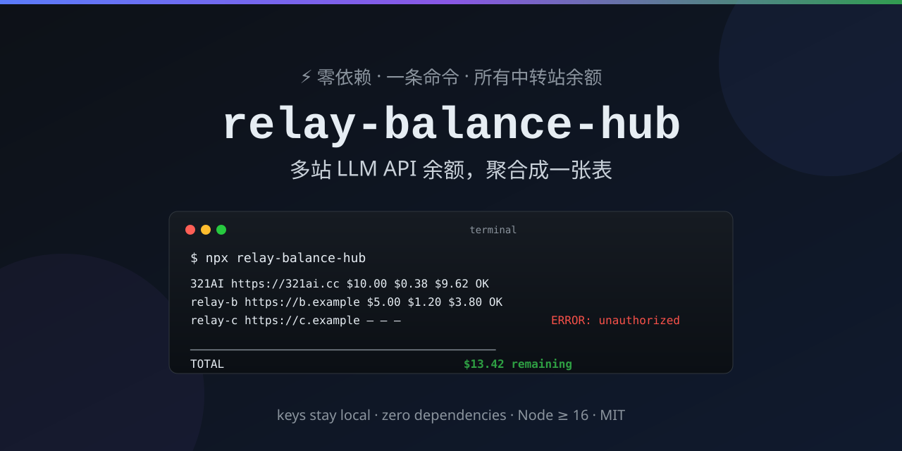

<div align="center">
  

# relay-balance-hub

[](https://github.com/aragorn-agent/relay-balance-hub/stargazers)
[](LICENSE)
[](package.json)
[](cli.js)
[](#-快速开始)
[](#-快速开始)
[](https://github.com/aragorn-agent/relay-balance-hub/stargazers)

**把你在所有 AI 中转站的余额，变成终端里的一张表。**

**One command. Every relay balance. Zero dependencies.**

```bash
npx relay-balance-hub --init
```

⭐ **如果这个工具帮你省掉了到处翻后台的时间，请务必点一颗星星——这是给开源作者最大的能量，也是持续更新的动力！** ⭐

</div>

---

## 📺 效果预览

```text
$ npx relay-balance-hub

SITE     BASE URL                TOTAL   USED 30D  REMAINING  STATUS
--------------------------------------------------------------------
321AI    https://321ai.cc        $10.00      $0.38      $9.62  OK
relay-b  https://b.example        $5.00      $1.20      $3.80  OK
relay-c  https://c.example           —          —         —  ERROR: unauthorized (check apiKey)
--------------------------------------------------------------------
TOTAL                                       $13.42 remaining
```

> 两行配置，3 秒查完。**再也不用登 5 个后台、翻 5 个页面去找"我还剩多少钱"。**

## ✨ 特性

- 🔌 **通吃 new-api / one-api 系中转站** —— 包括 [321ai.cc](https://321ai.cc) 在内的绝大多数国内中转平台，只要控制台能查余额就能查
- 📦 **零依赖** —— 单文件，Node ≥ 16 即跑，没有 `npm install`，没有供应链焦虑
- 🔐 **密钥不出本机** —— 只向你配置的站点发起两个免费计费查询；支持 `$ENV_VAR` 展开，密钥可以只放环境变量
- 💰 **免费查询** —— 调的是站点标准计费接口（每站 2 个 GET），**不消耗任何模型额度**
- 📤 **JSON / CSV 导出** —— `--json` 给脚本用，`--csv` 给表格用
- ⏰ **退出码友好** —— 全部成功 `0`、有失败 `1`，直接接 cron 定时检查 + 告警

## 🚀 快速开始

```bash
# 1. 生成配置模板
npx relay-balance-hub --init

# 2. 编辑 balances.json —— 每个中转站一条
#    { "name": "321AI", "baseUrl": "https://321ai.cc", "apiKey": "sk-..." }

# 3. 一键查询
npx relay-balance-hub
```

> 💡 没有中转站？[321ai.cc](https://321ai.cc) 注册送体验金，OpenAI / Anthropic 双协议兼容，[131 个模型实时比价](https://321ai.cc/models/)。

## ⚙️ 配置

```json
{
  "sites": [
    { "name": "321AI",         "baseUrl": "https://321ai.cc",          "apiKey": "sk-YOUR_KEY" },
    { "name": "another-relay", "baseUrl": "https://relay.example.com", "apiKey": "$MY_OTHER_KEY" }
  ]
}
```

| 字段 | 必填 | 说明 |
|---|---|---|
| `name` | 否 | 显示名（默认 `site-N`） |
| `baseUrl` | **是** | 站点根地址，工具自己拼 `/v1/dashboard/...` |
| `apiKey` | **是** | 各站控制台"令牌"页的密钥；支持 `$ENV_VAR` / `${ENV_VAR}` 展开 |

<details>
<summary><strong>命令行参数</strong></summary>

```text
-c, --config <file>   配置文件（默认当前目录 balances.json）
--init                写入配置模板
--json                JSON 输出（脚本友好）
--csv <file>          同时导出 CSV
--timeout <ms>        单站超时（默认 12000）
-v, --version         版本号
```

退出码：全部成功 `0` · 有站点失败 `1` · 配置错误 `2`

</details>

## 🔧 工作原理

调用 new-api / one-api 系中转站标配的计费接口：

```text
GET {baseUrl}/v1/dashboard/billing/subscription  →  { "hard_limit_usd": 10.0 }   总额度
GET {baseUrl}/v1/dashboard/billing/usage?...     →  { "total_usage": 38 }       已用（美分）
剩余 = 总额度 − 已用 / 100
```

## 🆚 对比

| 方式 | 每次耗时 | 密钥暴露 | 不绑定任何一家 |
|---|---|---|---|
| 手动登 N 个后台 | 2-5 分钟 × N | 浏览器会话 | ❌ |
| 手抄进表格 | 更惨 | — | ❌ |
| LiteLLM 预算跟踪 | — | 需要 LiteLLM 代理接管请求链路 | — |
| **relay-balance-hub** | **3 秒 × 全部站点** | 本地文件 / 环境变量 | ✅ |

## ❓ FAQ

<details>
<summary><strong>我的 API Key 会被发到别的地方吗？</strong></summary>
不会。每个密钥只作为 Authorization 头发给它所属的站点（2 个计费 GET）。工具无统计、无遥测、无任何超出你配置站点之外的网络请求。
</details>

<details>
<summary><strong>某个站返回 404 / 返回了一堆 HTML？</strong></summary>
该站没实现 new-api 的计费接口。欢迎提 issue 附上（脱敏后的）响应，我们来适配。
</details>

<details>
<summary><strong>支持 OpenAI / Anthropic 官方 API 吗？</strong></summary>
官方 API 的计费接口不同（且需要绑卡的组织）；本工具瞄准的是中转/聚合平台——恰恰是"多站余额满天飞"问题真正存在的地方。
</details>

<details>
<summary><strong>给 coding agent 的说明</strong></summary>
本仓库自带 <a href="llms.txt">llms.txt</a>：单文件 Node CLI、零依赖、配置驱动、读 subscription/usage 两个计费端点、输出 USD 计的 {total, used_30d, remaining}。
</details>

## 🌏 English

**relay-balance-hub** — check remaining balance across all your OpenAI-compatible LLM API relay sites in one command. Single-file Node CLI (≥16), zero dependencies. Reads each site's billing endpoints (`/v1/dashboard/billing/subscription` + `/usage`), prints per-site {total, used, remaining} in USD plus totals. API keys stay local (env-var expansion supported). Works with any [new-api](https://github.com/QuantumNous/new-api)/[one-api](https://github.com/songquanpeng/one-api) based relay. See the quick start above — config is three fields per site.

## 📈 Star History

[](https://star-history.com/#aragorn-agent/relay-balance-hub&Date)

---

<div align="center">

**Built with ❤️ by the [321AI](https://321ai.cc) team**

一个账号 · 多商家竞价供货 · [131 个模型实时比价](https://321ai.cc/models/) · 注册送体验金

<sub>如果这个工具对你有用，也欢迎试试我们的主站 → <a href="https://321ai.cc">321ai.cc</a></sub>

</div>
